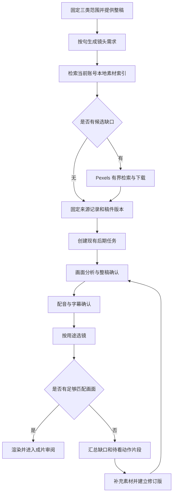

# 行业视频素材入口：第一版设计

日期：2026-10-13（Asia/Shanghai）

目标工程：`F:/codex/laox_account/video_postprod`

状态：已按用户纠正固定三类范围；首批 6 条素材已下载，主会话已独立完成 6 条完整解码及元数据复核。自动化模块尚未实现。本文描述的新增自动化能力仍是设计，不代表自动链路已部署；首批素材来源和使用限制保存在本批索引中，下载不等于动作连续性或成片验收。

## 1. 已确认目标与范围

用户希望减少手工找素材、下载、整理和合成的压力。行业范围已由用户固定：食品、饮品、日常生活为已确定的默认范围，运行时不要求、也不提供每次选择行业的步骤，分类由系统在固定三类范围内完成，仅用于筛选结果。第一版采用 Pexels 按需检索、本地复用、通用场景分类，接入现有后期流程；不增加自动发布。2026-10-13 用户回复：“可以，完善方案细节去做吧”；最新纠正：“不是我去选择行业，我已经给你固定好，现在就可以做导入了”。

交付体验：食品、饮品和日常生活已固定，系统自行分类。后续用户提供完整稿件并开启“联网补充场景素材”，系统先找本地可复用视频，再联网补缺，自动下载与登记，并将候选交给现有分析、选镜和合成。整稿、配音、字幕、成片沿用现有确认环节。素材不足集中呈现，已经找到的素材保留。

第一版从粘贴整稿或已确认稿件开始。只有主题、尚无整稿时，先使用现有写稿功能；不从网络素材反推正文，不另造写稿模块。搜索页不调用视觉或语言模型；进入剪辑任务后，画面分析使用该任务既有提供商和预算。

本次用户已授权立即进行首批通用库存素材采集，无需再次选择行业或批准采集方案。首批尚无当期稿件，按固定三类先积累候选；不声称已匹配当期台词或通过用户审核。当前未配置 Pexels API 密钥，由 Xagent 通过既有网页正常预览和下载流程执行，存入 `artifacts/stock/laoX/20261013_initial/`，首次目标每类 2 条共 6 条，仅是本批规模，不是长期固定比例。真实数量、技术检查和查看范围以该目录记录为准，不预写成功结果。本次不配音、不生成、不合成；网页采集不等于后续 API 自动化已经实现。前述整稿条件仅适用于按稿自动匹配，不阻止此次用户明确要求的首批导入。

本功能属于通用后期引擎，启用入口是本次新增的“联网补充场景素材”。不修改独立 X 的图片参考＋AutoDL H3 路线，不修改历史任务、固定人物声音、首尾、音乐或左上角固定文字政策，不加载任何本地模型来做搜索或健康检查。

## 2. 当前代码事实与接入缺口

| 已读实现 | 当前能力 | 本次处理 |
|---|---|---|
| `scheduler/service.py` 的 `/v1/imports` | 校验、完整解码、内容哈希、来源文件 | 抽取可复用的文件入库步骤；新增 stock 来源，不能沿用 `user_imported_h3` 标签 |
| `contracts/edit-job-v2.schema.json` | 自由素材只定义 `role=product`；三种选镜模式 | 为新任务增加明确的通用素材角色和脚本需求引用 |
| `scheduler/shot_library.py` | 只将 product 素材放入自由候选库 | 显式接收 stock 场景素材，候选保留来源类别 |
| `scheduler/shot_planner.py` | 产品词限制、动作区间确认、逐句及整段模式 | 增加逐句用途分流；不删除或放宽商品镜头的原门禁 |
| `scheduler/material_manifest.py` | 接收经过审核、绑定具体产品的导演实验素材清单 | 不将网络素材伪造成 PASS 清单，不复用其商品身份通过标志 |
| `scheduler/pipeline.py` | 导入→分析→建库→整稿确认→配音字幕→选镜合成 | 保留顺序；新需求绑定原稿，发现稿件变动立即使匹配失效 |
| `scheduler/revision_plan.py` | 增量重跑与资产复用 | 增加来源计划变化的失效规则，补充资产改变必须重新选镜的测试 |
| `scheduler/security.py` | 本机令牌读取和 Windows 加密存储约定 | Pexels 密钥仅服务端读取，浏览器不直接调用 Pexels |

工作区存在大量既有未提交修改，整个后期目录尚未被当前仓库完整跟踪。实施前按文件记录基线，不执行整仓重置、全量暂存或清理。本文不把仓库 HEAD 当作当前实现版本。

## 3. 方案选择与完整流程

不采用提前大规模下载行业库：成本、空间和审核工作会随无用素材增长。也不采用每次从零搜索：重复下载和分析无法减少长期压力。选择“任务驱动的检索＋已用素材沉淀”。

“有候选”只代表找到了文件，不代表画面审核通过。搜索结束的界面显示“候选已导入”；只有实际选镜完成才显示“镜头已匹配”。

## 4. 分类与镜头用途

行业配置固定为下列三类，由系统分类；用户不需要每次选择行业。分类标签可用于筛选已入库结果。配置只维护检索词和排除词，不携带品牌背书、功效或实测结论。

| 行业 | 第一版子类 | 常见场景 | 动作词种子 |
|---|---|---|---|
| 食品 `food` | 水果、蔬菜、坚果、谷物、面包、普通零食 | 早餐桌、厨房、超市、办公桌 | 清洗、切开、盛放、取出 |
| 饮品 `drink` | 水、茶、咖啡、牛奶、果汁 | 厨房、餐桌、咖啡馆、办公室 | 倒入、冲泡、搅拌、端杯 |
| 日常生活 `daily_life` | 做饭、收纳、办公、通勤、居家休息 | 家庭、办公室、街道 | 整理、拿取、放下、行走 |

每条需求包含：稳定句号、原句哈希、行业、对象词、动作词、场景词、排除词、用途、估计时长。确定性分句复用 `split_sentences`；词表提供中英查询词。含糊需求保留待补，不凭空填动作。精确时长由实际配音确定，检索阶段的估时不作为剪辑落点。

用途明确分为：

- `generic_scene`：通用场景、普通物品外观，例如早餐桌、厨房、办公室，不证明具体品牌与产品效果。
- `generic_action`：普通对象的具体动作，例如倒水、切苹果；需核对连续动作，抽帧仅作为待看线索。
- `product_specific`：本款包装、标签、内部结构、制作过程、实测或对比；沿用原产品素材限制，不由 Pexels 通用视频满足。
- `unresolved`：对象、动作或事实归属不清，列入待处理；不自动降级为场景图。

含品牌/型号/本款/实测/比较结果，或一句同时混合场景与具体产品事实时，按 `product_specific` 或 `unresolved` 保守处理。纯场景句可以在全片有商品关键词时使用通用素材，不把全片商品锁一刀切施加到这些句子。用户可在整稿确认处调整画面用途，但不能用通用用途绕过明确的品牌和实测表述；这类冲突须改稿或补正确素材。

示例仅用于验证分类：

| 原句 | 用途 | 可接受画面 |
|---|---|---|
| 早晨的厨房已经忙起来了。 | generic_scene | 厨房环境 |
| 把水慢慢倒进杯子。 | generic_action | 连续可见倒水动作，确认源区间 |
| 看这款饮料瓶上的配料表。 | product_specific | 对应商品标签 |
| 这款喝完让我一天都有精神。 | product_specific | 不通过库存视频给功效或个人经历补证据 |

## 5. 检索、下载与缓存

来源第一版只有 Pexels。使用官方 `GET https://api.pexels.com/v1/videos/search`；支持 query、orientation、size、locale、page、per_page。行业由本地词表映射为 query，不虚构 provider 的 industry 参数。视频搜索接口没有最短/最长时长查询参数，时长在响应和本地文件上筛选。

默认先查 portrait，再在缺候选时查可裁切的 landscape。响应中的宽高不能证明裁切后主体完整；实际分析/预览再判断。选择满足目标 768×1376 裁切需求的较小 MP4 档位；不能满足时保留缺口，不自动放大低清视频。完整解码、实际流宽高/时长和文件哈希检查失败不得入可用库。

第一版可配置默认上限（这些是设计值，不是已授权费用）：

| 项目 | 默认值与行为 |
|---|---|
| 每次任务最大镜头需求 | 20 条，超出提示分批 |
| 每条缺口检索 | 最多 2 组查询、每组 1 页、每页 10 个结果 |
| 每次任务 API 请求 | 最多 40 次，重试也计数 |
| 单次任务下载 | 最多 10 个视频、总量 1 GiB；单文件最多 256 MiB |
| 首轮候选分配 | 每个缺口先取 1 个，再轮转补充，避免首句占完下载配额 |
| 素材长度 | 默认接收 3–90 秒；最终足够长度由声音与选镜决定 |
| 搜索响应缓存 | 24 小时；缓存键包含来源、标准化查询及全部筛选参数 |
| HTTP 超时 | 连接 10 秒、单次读取 30 秒、单文件总时限 180 秒 |
| 并发 | API 查询串行；最多 2 个下载任务 |
| 重试 | 连接失败/5xx 最多额外 2 次，退避 2 秒、8 秒；401/403 不重试；429 暂停并显示恢复时间，不循环打满 |

按 provider 限额响应头约束全局请求，官方默认额度只作初始保守值，不作为账户已获额度。授权头仅发送给 Pexels API 主机，下载 CDN 不带密钥。视频 URL 只来自服务端保存的真实 API 响应；限定 HTTPS 和允许主机，重定向逐跳校验，拒绝本机、内网与未知主机。用户不能给下载接口传任意 URL。

文件先写本请求目录的 `.part`，流式计数限制体积，校验成功后原子发布。取消、失败或重启只回收该请求未完成的临时文件，已成功入库视频保留。首版不做断点续传；恢复时复用完整文件，重新下载不完整文件。

去重分两层：provider＋video_id＋file_id 防止重复下载；内容 SHA256 防止不同条目写入相同文件。文件字节可以物理共享，账号的可见索引、素材授权与使用记录分别隔离；第一版不跨账号推荐素材，不把其他账号的画面、声音、品牌资源带入老X任务。

## 6. 数据与状态

新增 `stock-request/v1`，独立于不可变的剪辑任务，允许本地素材为空；成功下载后再生成至少含一个资产的 `edit-job/v2`。请求保存账号、完整稿件哈希、词表/配置版本哈希、查询与限额、已有素材引用、候选与缺口、时间戳、取消状态及幂等键。相同幂等键不同输入返回冲突。

请求状态：`PLANNED → SEARCHING → DOWNLOADING → READY`。可分支为 `PARTIAL`、`RATE_LIMITED`、`NEEDS_CREDENTIAL`、`FAILED`、`CANCELLED`。READY 只表示下载候选就绪；PARTIAL 保留可用文件和逐需求原因。请求过程不修改已经提交的 job payload。重启后进行中的请求标记 `INTERRUPTED`，用户恢复时继续相同请求和总限额，不自动开始历史任务。

先完成本地索引查询，再检查联网凭据；本地已覆盖需求时没有密钥也可 READY。PARTIAL 可以对已有素材建任务，但其余需求必须在用途计划中保留为缺口。零候选不能创建剪辑任务。恢复只适用于可重试的中断、限流及缺凭据状态；取消后需创建新请求，不能被后台重新拉起。

新增 `stock-source/v1`，记录来源网站、页面、作者及作者页、video_id/file_id、检索词、采集 UTC、许可说明页、API 元数据哈希、实际文件哈希/时长/尺寸、下载档位、用途限制。固定 `origin=pexels_stock`、`product_identity_verified=false`、`real_product_test=false`、`generated=false`。来源文字不能当模型指令执行。

建议持久化布局：

- `config/stock_materials.json`：启用开关、上限、允许域名、配置版本；不含密钥。
- `config/stock_taxonomy.json`：三个行业、中英同义词、排除词及版本。
- `state/stock/requests/<request_id>/`：请求和检索回执；原子写入，每请求锁。
- `state/stock/catalog.sqlite`：单独的可重建索引，避免给现有 jobs 数据库做破坏性迁移；保存来源映射、账号可见性、分析引用、使用记录、幂等关系和下载锁。
- `artifacts/stock/<sha前两位>/<sha>.mp4`：验证过的原始文件；来源快照单独保存，不篡改媒体。
- `jobs/<job_id>/rev-XXXX/stock-plan.json`：本次稿件、句子用途、候选来源和缺口的不可变快照。

索引是检索加速层，来源快照和任务快照是回放依据。账号、哈希、边界和源文件检查在消费时再做，不能因为库里有记录就直接信任。

每个最终时间线的素材使用记录以 `(job_id, revision, timeline_hash, asset_hash, source_window)` 幂等登记；区分已渲染、已审阅，不把预览当发布。排序时对当前账号最近 10 条已渲染任务中使用过的同一视频降权，不硬性排除唯一合适素材；同一成片内仍沿用现有源区间不重复规则。

## 7. 与后期合同、选镜和缓存的融合

对 `edit-job/v2` 做可选扩展，历史输入没有新字段时行为不变：

1. 新增 `assets[].role=stock_scene`，仅允许 `mode=broll`、`locked=null`，来源必须验证为 `stock-source/v1`。商品与固定角色不改。
2. 新增可选 `stock_plan_ref={path, sha256}`，其中绑定账号、请求 ID、稿件哈希、配置/词表版本及每句用途；存在 stock_scene 时必须提供。
3. 新入口第一版明确使用 `selection_mode=precise`，界面标为“按稿配场景”。现有 whole_clip/beat 不改；若新 stock 资产被传给这两种模式，返回明确的不支持错误，不能忽略资产或静默切模式。
4. 扩展候选合同，保留来源类别及来源记录哈希；旧候选缺失来源类别按旧 product 语义处理。输入参数不能把 stock 改标成 product 绕过规则，必须交叉验证可信来源快照。
5. 整稿确认时确认该版用途表；确认必须绑定脚本哈希和用途计划哈希。正文删句或改动造成哈希不符时，需要重建用途计划，不沿用旧通过状态。

新建 `scheduler/stock_matching.py` 提供明确的用途匹配入口。`product_specific` 继续调用原产品检查；`generic_scene` 只在实际画面分析支持对象/场景、没有明显冲突、可裁切、时长够用时使用 stock；`generic_action` 继续需要绑定文件哈希、动作对象、源区间的实际审核证据。词表新增倒水/冲泡/搅拌等动作时使用独立 stock 动作表，不伪装成现有包装开启动作，也不把静态“杯子有水”判为“倒水”。

用途分流须贯通自动选镜、备选列表、手工换镜和拆分补镜；不能只改主入口。通用候选排序按对象/场景匹配、动作证据、裁切、足够时长、近期使用降权、确定性哈希顺序进行，不再误用商品关键词评分。裁切未确认时标明待看，不能把数学上宽高足够当作主体保留。新增动作确认记录位于 stock-plan 的证据引用中，绑定动作枚举、对象、文件哈希、起止 tick、确认者与依据；不写入枚举不兼容的旧商品动作字段。证据文件变化需要新计划版本。

搜索标题、作者标签和缩略图只能排序候选，不能作为最终选镜证据。暂不支持自动证明动作连续性的镜头集中显示可播放候选和待确认区间；不新增每个下载都要批准的环节。已确认动作证据绑定原文件哈希后可复用，换文件失效。

视觉分析复用既有 Narrato 操作、提供商和预算网关，不增加模型路线。首轮先分析各需求排名最高的候选，足够则停止；失败或不匹配再处理下一候选，预算不足显示具体缺口。需要为 stock 分支把“只分析准备采用的候选”接入现有逐文件循环，不能一次把所有搜索结果全部计费分析。

配音之前的“足够”仅表示已找到与需求相符、满足估时的候选；配音之后按实际句长重新校验。若实际时长造成缺口，先使用已下载的剩余候选并在原任务额度内分析；仍不足则提示补素材并创建修订版，不静默增加下载或分析额度。选择器拒绝原因须进入逐句缺口报告。

缓存键至少绑定媒体哈希、分析模型路由与版本、提示词版本、采样/切镜参数、裁切设置。不同稿件可复用纯画面观察；用途匹配和排序必须重新根据稿件、配置及历史使用记录计算。复用前检查结果文件及证据哈希。现有缓存是否满足该粒度要用验收测试证明，不能仅据文档声称不会重复计费。

修订失效矩阵：

| 改动 | 必须重做 | 可复用 |
|---|---|---|
| 只换字幕 | 字幕布局和相关渲染 | 检索、下载、分析、配音、选镜 |
| 只换配乐 | 混音和封装 | 素材、画面分析、配音、选镜 |
| 补素材/换素材 | 新文件分析、建库、选镜及受影响画面 | 未变文件分析、原稿、已确认配音 |
| 改用途/镜头需求 | 用途确认、检索缺口、选镜和画面 | 未变文件分析、正文未变时的配音 |
| 改正文 | 需求计划、整稿确认、必要配音字幕和选镜 | 哈希与分析参数仍一致的原素材观察 |

## 8. 界面与 API

新增素材区“联网补充场景素材”：固定显示食品、饮品、日常生活范围，不设置行业必选步骤；提供自动生成的镜头需求列表、下载数量/容量上限、开始/取消按钮。三类标签只用于筛选结果。自动联网开关默认关闭，已有手工流程可直接使用；此次首批网页采集已有明确授权，立即执行，不等待这个新界面上线。第一版不提供定时采集或无人值守后台抓取。

点击“查找并补充素材”后展示分阶段进度、已复用/新下载数量、每句候选与缺口。结果以安全文本和本地视频预览展示；素材卡链接至 Pexels 原页面和作者页，并在结果区标明来源。署名和来源信息放素材界面与交付记录，不自动烧录进视频。

“用于这次剪辑”将候选加入任务，进入现有整稿、配音、字幕和成片流程。用户不必手工复制文件路径或 JSON。网络失败仍可继续使用已有本地素材；确实缺镜头时不能自动凑满成片。

新增路由采用独立 `scheduler/stock_api.py` 注册到现有 app，复用当前 operator 验证、同源检查和本地会话：

| 路由 | 行为 |
|---|---|
| `GET /v2/stock/capabilities` | 返回启用状态、行业和上限，以及密钥是否配置；不返回密钥 |
| `POST /v2/stock/requests` | 创建带稿件的采集请求，要求 Idempotency-Key |
| `GET /v2/stock/requests/{id}` | 状态、候选和缺口；仅当前账号上下文可消费 |
| `POST /v2/stock/requests/{id}/resume` | 显式恢复中断/限流请求，沿用已消耗上限 |
| `POST /v2/stock/requests/{id}/cancel` | 停止新检索和下载，保留成功素材 |
| `POST /v2/stock/requests/{id}/materialize` | 输出绑定脚本/账号/来源哈希的任务素材引用和 stock-plan；重复调用幂等 |

网络处理放有界后台执行器，不阻塞 HTTP 请求，也不新增模型常驻进程。采集服务与现有任务队列共享 app 生命周期；退出时停止新工作并记录未完成请求。

## 9. 密钥、预算及上线前提

Pexels 需要用户账户的 API key。先以 `POSTPROD_PEXELS_TOKEN` 或已有 Windows 加密存储约定读取，不在聊天、日志、任务文件、前端或版本库暴露值。缺失时返回 `NEEDS_CREDENTIAL`；不注册账户、不复制其他程序凭据、不改全局认证。离线测试不需要真实密钥。

采集请求只统计 API 请求、下载字节和文件数量，不声称“完全零成本”。画面分析在现有剪辑任务内部执行并计入该任务额度；默认 2 元/40 次是当前模板设置，本功能不提高上限。预算不足、付费结果未知继续遵守现有停止与核销行为。

实际上线分为三个事实：代码与离线验收通过、真实检索下载通过、带真实素材的成片验收通过。它们分别记录，不能用其中一个替代另两个。真实检索需配置密钥；真实分析需用户在现有 UI 开启该任务费用额度；最终成片需人工观看。

## 10. 文件范围与拆分边界

新增主体模块：`providers/pexels.py`、`scheduler/stock_materials.py`、`scheduler/stock_catalog.py`、`scheduler/stock_matching.py`、`scheduler/stock_api.py`；配置和三个独立合同分别对应请求、来源、用途计划。根据实现体量可在同目录拆分网络与下载，不引入第二套视频渲染器。

必要接入文件：`scheduler/service.py`、`scheduler/contracts.py`、`scheduler/pipeline.py`、`scheduler/shot_library.py`、`scheduler/shot_planner.py`、`scheduler/revision_plan.py`、`contracts/edit-job-v2.schema.json`、`contracts/shot-library-v1.schema.json`、`ui/index.html`、`ui/app.js`、`ui/style.css`、相关新测试与操作手册。

不改：上层 H3 Runtime、X/Xagent 定义、已有声音和品牌资产、历史 jobs、上游工作副本、全局模型和认证配置。不得整包复制 MoneyPrinterPlus 代码；只借鉴素材入口概念，使用官方 API 和本项目现有实现。

建议实施拆为四个连续可验收部分：来源/分类合同及客户端 → 有界采集与本地索引 → 选镜与缓存接入 → UI 和端到端验证。同一文件一个执行者；若按项目偏好交给 ZCode 执行有界任务，必须给出允许文件、禁止项、测试和回退条件，完成后独立复核。不把原生 headless 结果称作 Orca worker_done。

## 11. 可观察验收

| 编号 | 场景 | 通过标准 |
|---|---|---|
| A01 | 未启用功能的原任务 | 合同、选镜、声音及固定片段回归测试通过，无新增联网 |
| A02 | 三行业确定性需求 | 句序/原句不变；词表版本可追溯；含品牌/实测句不分类为通用场景 |
| A03 | API 查询 | 使用当前视频接口，正确发送 query 等参数；不发送虚构时长/行业参数；密钥不进入日志 |
| A04 | 重复查询/下载 | 24 小时缓存命中不联网；完整文件重用；并发同素材只发布一个完整文件 |
| A05 | 异常媒体 | HTML 假 MP4、损坏视频、超体积、越界 URL、无可用视频流都被拒绝；无完整记录残留 |
| A06 | 网络异常/取消/重启 | 上限不重置；401 不重试；429 停止；取消不再启动下载；已成功素材仍可用 |
| A07 | 来源真实性 | 所有 stock 记录保持非商品身份、非实测；伪改角色/哈希/来源拒绝；不伪造人工通过 |
| A08 | 场景与商品混用 | 同一整稿中厨房句可选厨房；商品包装句不能选普通瓶子；未知用途保持缺口 |
| A09 | 动作反例 | 杯中静态有水不能证明倒水；已确认连续倒水区间可以用；更换文件使旧确认失效 |
| A10 | 旧模式兼容 | whole_clip/beat 原任务保持原行为；stock 请求错误混入时有明确错误 |
| A11 | 增量修订 | 字幕/配乐修订没有新搜索、下载、分析、TTS；补素材重做选镜；改稿旧用途确认失效 |
| A12 | 账号隔离 | 相同物理文件可去重，但账户不能枚举或消费其他账户的素材索引和私有资产 |
| A13 | 费用与模型 | 搜索/下载阶段模型调用 0；预算不足不继续分析；未知付费结果不重发；本地模型按需退出 |
| A14 | 浏览器流程 | 固定三类范围，无需行业选择→采集进度→候选预览→加入剪辑可走通；错误和缺口可见；来源文字安全呈现 |
| A15 | 真实完整样片 | 在食品、饮品、日常生活各做 1 条短稿验证；实际文件可解码，音画字幕及来源记录经审阅，无固定制作角标 |

测试先使用保存的 API 响应夹具、小型合成视频和隔离临时目录，测试数据不得进入生产索引。核心测试预计分为 `test_pexels.py`、`test_stock_catalog.py`、`test_stock_requests.py`、`test_stock_matching.py`、`test_stock_api.py`、`test_stock_pipeline.py`，并覆盖现有合同、增量、逐句、整段、节奏、账号与模型生命周期测试。具体命令在实施计划中依据真实解释器确定。

统计检索次数、字节、下载/分析缓存命中、每句匹配/缺口、人工操作次数及各阶段耗时。首轮给出实测数据，不预先承诺节省百分比或成片质量提升。

## 12. 回退

上线默认 `enabled=false`；测试通过且密钥就绪后才启用新入口。关闭开关阻止新采集，不删除已下载原件或任务引用。回退 UI 时保留新合同读取与已导入素材渲染兼容；若回退整个代码版本，先停止 stock 新任务并保留支持新合同的版本用于回放，不能让旧代码处理新角色。

本次新增目录单独备份，文件按哈希可核对。索引可以从来源与请求快照重建；不递归删除 assets/artifacts/jobs，也不清理共享模型和声音。现有 jobs 数据库格式不改变，原任务流程不依赖新索引。

## 13. 依据与自检

- 本地事实：2026-10-13 只读检查本目录 README、操作手册、合同、导入 API、选镜、索引、增量与账户代码；未运行生成服务或推理。
- 官方接口：[Pexels API 文档](https://www.pexels.com/api/documentation/)，2026-10-13 核对新视频接口、认证、检索参数、来源展示和限额响应头。本文不把网站视频许可与 API 使用要求混为一谈。
- 现行项目边界：`../docs/content/PEXELS_MATERIAL_WORKFLOW.md`、`../config/x_visual_first_policy.json`；新 API 入口只属于本次批准的通用后期功能，不自动改独立 X 的既有配置。
- 自检要求：稿件先于需求；候选不等于审核；通用素材不等于商品；采集额度不等于模型额度；数据保存不等于发布；旧任务不自动切路线。

设计层没有未选技术分支。实施前保留的外部就绪条件是 Pexels 密钥、实际 API/CDN 响应兼容性与任务费用授权；未验证项必须在交付记录中如实标出。

设计自检已完成：检查了范围、状态、身份边界、哈希失效、缓存和预算的一致性；补齐无密钥本地复用、零候选、动作枚举隔离、换镜同规则与配音后时长再校验。未运行实现测试、真实 API 检索或样片生成；A01–A15 均是待执行的验收要求。

### 用户纠正后的首批实际采集记录

固定范围为食品、饮品、日常生活，已通过正常网页取得真实下载链接并保存 6 条文件；未配置 API 密钥。材料目录为 `artifacts/stock/laoX/20261013_initial/`。2026-10-13 主会话独立复核结果：

| 类别 | Pexels ID | 实际宽×高 | 实际秒数 | 完整解码 |
|---|---|---|---|---|
| 食品 | 8798821 | 720×1280 | 12.887875 | exit 0；低于目标画幅，保留低清限制 |
| 食品 | 6666671 | 1440×2496 | 9.386667 | exit 0 |
| 饮品 | 28903690 | 1080×1920 | 13.680333 | exit 0 |
| 饮品 | 8810918 | 1080×1920 | 9.960000 | exit 0 |
| 日常生活 | 5681376 | 1440×2560 | 4.926667 | exit 0 |
| 日常生活 | 8128422 | 1440×2560 | 7.000000 | exit 0 |

主会话还查看了 6 张抽帧拼图；没有将抽帧观察登记为完整连续动作验收。键盘片段偏暗光/RGB氛围，不能默认代表普通白天办公室；金属壶倒饮品片段不能单凭画面确认饮品种类。全部素材是通用库存候选，不是具体产品实测，也没有用户人工 PASS。这次完成实际文件入库，不代表新的自动 API/选镜合同已接通。
